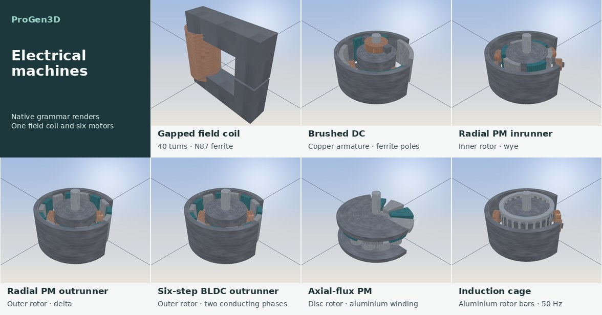

# Electrical machines

Open a study in the desktop editor, choose **Fit Extents**, then open **Electrical Controls** and expand a wire, coil, magnet or motor. Each file contains the complete grammar. Dimensions are in metres. The rotor angle follows the prescribed shaft speed through the grammar time variable `t`.



| Study | Construction and excitation | Change to try |
|---|---|---|
| [Gapped field coil](GappedFieldCoil.p3d) | 40 turns of polyimide-insulated copper around a square N87 return with a 1 mm gap | Double the gap in the `Bench` call. Inspect the change in inductance and flux density. |
| [Brushed DC](BrushedDC.p3d) | Segmented commutator, copper rotor winding and four fixed ceramic poles | Reverse the magnet polarity. Check the signs of torque and back EMF. |
| [Radial PM inrunner](RadialInrunner.p3d) | Inner six-pole NdFeB rotor, outer copper stator, wye | Change the connection to delta. Compare line current and line-to-line RMS back EMF at the same phase current. |
| [Radial PM outrunner](RadialOutrunner.p3d) | Outer 14-pole bell, inner copper stator, sinusoidal delta drive | Compare against the six-step example at matching speed and peak current. |
| [Six-step BLDC outrunner](SixStepOutrunner.p3d) | Wye-connected fan motor with 120-degree conduction, two active phases and trapezoidal back EMF | Change the conducting current. Double it to double torque and quadruple winding loss. |
| [Axial-flux PM](AxialFlux.p3d) | Disc rotor, axial gap, laminated return and aluminium phase windings | Substitute copper in `PhaseWire` and compare winding loss at fixed current. |
| [Induction cage](InductionCage.p3d) | Copper stator and 24 aluminium cage paths, 50 Hz, two pole pairs | Set shaft speed to 0, 1450, 1500 and 1600 rpm to inspect starting, motoring, synchronous and generating operation. |

The field-coil mesh resolves every turn. Motor meshes use winding envelopes, cutaway return paths, steel teeth, and representative poles or bars. The numeric winding is the equivalent series path per phase, or the equivalent armature for DC. Its turns need not equal the number of visible envelopes. The material selected by a grammar declaration sets its electrical characteristics. The `material(...)` attached to a mesh sets its appearance.

## Author a machine

An ID is unique within the scene's machine model. References may precede definitions. Numeric fields accept ordinary ProGen3D expressions, including rule parameters and `t`. A missing reference, incompatible field, or invalid dimension produces a source diagnostic before any machine objects or geometry are committed.

```text
Start ->
    MagnetWire(Lead material(Copper) insulation(Polyimide)
               diameter(0.0006) thickness(0.000025) temperature(20))
    FieldCoil(Pickup wire(Lead) core(FerriteN87) turns(40) turnLength(0.05027)
              coreLength(0.119) area(0.0001) gap(0.001) current(1.6) insulationVoltage(2))
    PermanentMagnet(Pole material(NdFeB35) returnCore(LaminatedSteel)
                   length(0.003) returnLength(0.085) area(0.00012) gap(0.001))
    ElectricMotor(Drive type(RadialInrunner) winding(Pickup) magnet(Pole)
                  connection(Wye) polePairs(3) rpm(1800) windingFactor(0.94))
```

This minimal grammar declares inspectable objects. Add normal geometry rules to draw them, as in the linked examples. A single winding or magnet definition may serve several comparison motors.

| Declaration | Required fields | Optional fields and defaults |
|---|---|---|
| `MagnetWire` | `material`, `insulation`, bare `diameter` (m), effective dielectric `thickness` (m) | `temperature(20)` °C |
| `FieldCoil` | `wire`, `core`, integer `turns`, mean `turnLength` (m), `coreLength` (m, excluding the gap), `area` (m²), total `gap` (m), signed `current` (A) | `insulationVoltage(0)` V across the specified dielectric thickness |
| `PermanentMagnet` | `material`, `returnCore`, magnet `length` along magnetisation (m), `returnLength` (m), common pole `area` (m²), total `gap` (m) | `polarity(1)`, either +1 or −1 |
| `ElectricMotor`, PM | `type`, `winding`, `magnet`, `connection`, integer `polePairs`, signed mechanical `rpm` | `windingFactor(1)` in (0,1] |
| `ElectricMotor`, induction | `type(InductionCage)`, `winding`, `connection`, `polePairs`, `rpm`, `barMaterial`, integer `bars`, `barLength` (m), `barArea` (m²), `barLeakage` (H), `barEmf` (standstill V RMS per equivalent path), `frequency` (Hz) | `barTemperature(20)` °C |

`BrushedDC` takes `Armature`. The three sinusoidal PM layouts and the induction model accept `Wye` and `Delta`. `SixStepOutrunner` models two conducting phases in `Wye`. DC current denotes signed armature current, six-step current denotes signed conducting plateau current, and sinusoidal current denotes signed peak phase current (q-axis for PM). For induction the supplied current specifies stator copper loss independently of the supplied standstill rotor EMF.

## Materials and field equations

| Catalog ID | Role | Property used |
|---|---|---|
| `Copper` | Winding or cage conductor | Resistivity at 20 °C, 1/58,000,000 Ω m. Temperature coefficient 0.00393/K. |
| `Aluminium` | Winding or cage conductor | 2.826 × 10⁻⁸ Ω m at 20 °C and 0.004/K, annealed conductor approximation. |
| `Polyimide` | Wire insulation | Relative permittivity 3.4, representative of 100HN film at 1 kHz. |
| `Air` | Magnetic path or dielectric space | Relative permeability and permittivity both approximated as 1. |
| `FerriteN87` | Soft MnZn core | Initial relative permeability 2200 at 25 °C. Flux range indicator at 0.490 T, the manufacturer's 25 °C value at 1200 A/m and 10 kHz. |
| `LaminatedSteel` | Generic soft electrical steel | Illustrative effective relative permeability 2000 and warning threshold 1.5 T. Both are model assumptions, independent of any particular steel grade. |
| `NdFeB35` | Permanent magnet | N35 nominal remanence 1.21 T. Assumed linear recoil relative permeability 1.05. |
| `FerriteC8` | Permanent magnet | Nominal remanence 0.385 T. Assumed linear recoil relative permeability 1.10. |

The conductor uses a linear temperature correction. Its resistive longitudinal field is E = ρJ, with J = I/A_wire and R = ρ N l_turn/A_wire. The planar dielectric estimate gives E_ins = ΔV/d and D = ε₀ εᵣ E_ins. Supply the local insulation voltage and total thickness across which it falls. These are distinct from the winding's end-to-end voltage and wire length.

A field coil uses a closed, equal-area magnetic circuit. Its reluctance is ℛ = (l_core/μᵣ + g)/(μ₀ A). Flux is Φ = NI/ℛ, flux density B = Φ/A, inductance L = N²/ℛ, and stored energy U = LI²/2. Reported H is B/(μ₀μᵣ) in the core and B/μ₀ in a gap. The permanent-magnet circuit uses a linear recoil line and gives B = polarity × Bᵣ l_m / [l_m + μ_rec (g + l_return/μ_return)]. Signed fields follow the authored circuit direction. A core range warning marks extrapolation; the displayed values then require a nonlinear B–H curve for quantitative use.

In the field-coil example, a 0.6 mm copper wire, 40 turns, 8 mm mean radius, and 0.66 mm pitch yield **0.1226 Ω**, **0.1907 mH**, and **0.07630 T** at 1.6 A. Copper dissipation is **0.3139 W**. The independently imposed 2 V across 25 µm gives **80 kV/m** in the insulation.

## Motor equations and scope

Let p denote pole pairs, Φ the PM flux per pole, ψ = N k_w Φ, and ω signed mechanical angular velocity. The brushless sinusoidal layouts share the surface-PM model with zero d-axis current. Their radial or axial geometry and material choices determine the authored flux path and winding data.

| Operating model | Torque and voltage | Resistive loss |
|---|---|---|
| Brushed armature | k = 2pψ/π, T = kI, signed terminal back EMF = kω | I²R for the equivalent armature |
| Sinusoidal, three phase | T = 1.5pψ I_peak, phase EMF peak = pψω. Wye line RMS voltage is √3 times phase RMS voltage. Delta line RMS current is √3 times phase RMS current. | 3 I_peak² R/2 |
| Six-step BLDC | Ideal 120° flat-top trapezoid with linear 60° transitions and instantaneous commutation. For a peak-to-peak linkage swing of 2ψ, k_flat = 12pψ/(5π). T = 2k_flat I_on and active-pair EMF = 2k_flat ω. RMS line current = √(2/3) times the current magnitude. | 2 I_on² R |
| Induction cage | Synchronous speed n_s = 60f/p and slip s = 1 − rpm/n_s. Each equivalent rotor path has R_b = ρl/A and X₀ = 2πfL_b. Its current magnitude is abs(s) E₀ / √(R_b² + s²X₀²). Torque = bars × s E₀² R_b / [(R_b² + s²X₀²)ω_s]. The formula is continuous through zero slip. | Stator 3 I_peak² R/2. Rotor bars × I_b² R_b. |

The inspector reports electromagnetic converted power Tω at the imposed speed. Bearing loss, windage, thermal transients, inverter switching ripple, leakage and fringing in the field circuits, eddy currents, hysteresis and irreversible demagnetisation are outside this implementation. The induction model uses effective independent cage paths. End-ring effects must be reflected in the input path parameters. These are steady operating points and one-dimensional fields. Torque does not automatically drive a rigid body, and `t` samples the prescribed motion.

## Verification and sources

Run `make electrical-check` from the repository root. The native tests load all seven grammars and check geometry, lexical variables, forward references, malformed definitions, material substitution, Ampère's law, PM recoil, zero-current inductance, polarity, connection conversions, commutation, and induction power balance at and across synchronous speed.

- Annealed conductor resistivities and temperature coefficients. [Copper Development Association, High Conductivity Copper](https://help.leonardo-energy.org/hc/en-us/article_attachments/360025632579)
- Ferrite permeability, flux density, and test conditions. [TDK SIFERRIT N87](https://www.tdk-electronics.tdk.com/download/528882/990c299b916e9f3eb7e44ad563b7f0b9/pdf-n87.pdf)
- Polyimide electrical properties. [DuPont motor and magnet-wire technical bulletin](https://www.beta.dupont.com/content/dam/electronics/amer/us/en/electronics/public/documents/en/EI-10139-Kapton-Motor-and-Magnet-Wire-Technical-Bulletin.pdf)
- Representative permanent-magnet remanence. [Arnold N35](https://www.arnoldmagnetics.com/wp-content/uploads/2017/11/N35-151021.pdf), [Allstar Ceramic 8](https://allstarmagnetics.com/wp-content/uploads/2024/09/Ceramic-Technical-Data-ASM.pdf)
- Magnetic circuits and electric-machine theory. [MIT 6.685 course notes](https://ocw.mit.edu/courses/6-685-electric-machines-fall-2013/pages/course-notes/)
