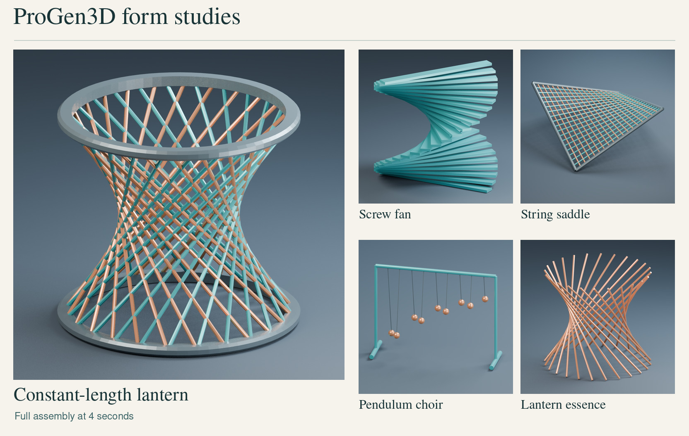
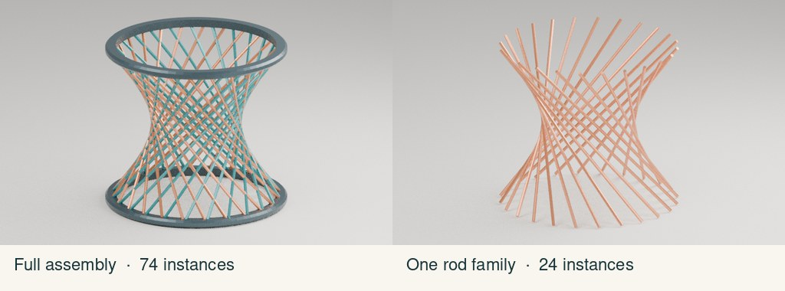

# Geometry from a rule

Five runnable desktop grammars explore four forms. Begin with a stack of straight slats. Work up to a moving lattice, then strip that lattice back to the three rules that determine its shape.



[Watch the 24-second motion study](images/motion.mp4). Both models share an on-screen clock. The pendulums complete one group cycle while the lantern completes three. The film uses native triangle buffers sampled at 16 frames per second. The stills use the same geometry with studio lighting.

| Grammar | Technique to learn | Instances | Triangles | Studio still |
|---|---|---:|---:|---|
| [Screw fan](01_screw_fan.p3d) | Give height and rotation the same repeat counter | 25 | 300 | [View](images/studio/01-Screw-Fan.jpg) |
| [String saddle](02_string_saddle.p3d) | Construct a surface from two families of straight lines | 38 | 1,280 | [View](images/studio/02-String-Saddle.jpg) |
| [Pendulum choir](03_pendulum_choir.p3d) | Turn an integer frequency schedule into lengths and angles | 23 | 3,120 | [View](images/studio/03-Pendulum-Choir.jpg) |
| [Constant-length lantern](04_constant_length_lantern.p3d) | Solve one dimension from a constraint at each time sample | 74 | 7,296 | [View](images/studio/04-Constant-Length-Lantern.jpg) |
| [Lantern essence](05_lantern_essence.p3d) | Recover the full copper family with three rules | 24 | 768 | [View](images/studio/05-Lantern-Essence.jpg) |

The studio stills show the pendulums at 12 seconds and both lanterns at 4 seconds. In the paired lantern view, identical camera position and scale make it possible to follow the same copper rod across both images. [Open the side-by-side comparison](images/studio/lantern-comparison.jpg).

## Run your first experiment

From the repository root, open the first file. In the editor, change `240` to `0` on the `Start` line and press **Run**. The 25 slats should align vertically. Change it to `-240` to reverse the handedness. Use **Fit** after changing the size. Open the choir or the lantern and use the preview playback control to advance grammar time.

```sh
./progen3d-editor-gui --open examples/FormStudies/01_screw_fan.p3d
```

## 1. Screw fan — count the gaps

The whole model fits in two rules. The bracketed branch gives each slat its own transform. Both expressions use the fraction `Slats_count/(n-1)`, which runs from zero through one. There are 24 gaps between 25 slats, so the last slat reaches both the specified rise and the specified twist.

```text
Start -> Slats(25 2.4 240)

Slats(n rise twist) n ->
    [ T(0 rise*Slats_count/(n-1) 0)
      A(twist*Slats_count/(n-1) 1)
      S(2.6 0.055 0.22)
      I(Cube material(tealmatteceramic) 1 1) ]
```

**Try it.** Set the count to 13. Before running, predict the pitch and turn per gap. They become 0.2 units and 20 degrees. The overall rise and twist stay the same. Use integer counts of at least two.

## 2. String saddle — draw the surface twice

Let `span` be the half-width and `lift` the signed height of the high corners. The centreline surface is $y=\mathrm{lift}\,xz/\mathrm{span}^2$. Hold $z$ constant and the equation becomes a straight line in $x$. Hold $x$ constant and you obtain a second straight line. The two calls to `SweepDisk` in `Pair` draw those two rulings at the same normalised station. Every interior crossing satisfies the same equation.

**Try it.** Change `Saddle(17 1.7 0.78)` to `Saddle(17 1.7 0)` to turn the saddle into a square grid. Then try a negative lift. The two previously low corners rise. Orbit down to the level of one border and follow a single string end to end. Each is straight even where the silhouette bends.

**What changed during testing.** Sampling the interval including both ends laid four strings directly on the four frame members. The final station rule uses `(Interior_count+1)/(n+1)` and reserves the boundary for the thicker frame. With 17 stations there are 34 interior strings and four distinct borders. The two coloured families intentionally intersect along their centrelines. A woven textile would need over-and-under offsets at each crossing.

Historical string models use straight generators to make ruled surfaces visible. [University of Arizona collection](https://archive.math.arizona.edu/models/Ruled_Surfaces/index.html) · [Science Museum Group saddle model](https://collection.sciencemuseumgroup.org.uk/objects/co59720)

## 3. Pendulum choir — design the return time first

Choose a common return time $T=24$ seconds. Pendulum $i$ completes $m_i=12+i$ cycles in that time. For $g=9.81$ m/s², the small-angle simple-pendulum model gives the length and the prescribed angle.

$$
L_i=g\left(\frac{T}{2\pi m_i}\right)^2,\qquad
\theta_i(t)=12^\circ\cos\left(\frac{2\pi m_i t}{T}\right).
$$

The outer rule counts pivots, `Voice` calculates the angle, and `Drop` places the bob centre precisely one length below the local pivot. The nine lengths range from 0.994 m to 0.358 m. The rack runs along X and each pendulum swings in the YZ plane. An oblique view makes the phase differences visible. Motion is prescribed from the small-angle solution. Damping, bob contacts and finite-amplitude period corrections would require a different model. [Harvard pendulum-wave demonstration](https://sciencedemonstrations.fas.harvard.edu/presentations/pendulum-waves) · [OpenStax derivation](https://openstax.org/books/university-physics-volume-1/pages/15-4-pendulums)

**Try it.** At 12 seconds, adjacent bobs should occupy opposite angular extremes. At 24 seconds, all return to their initial angle. For a control, replace `Voice(period first+Voices_count)` with `Voice(period first)`. All nine now share a length and phase. At 6 seconds their front-to-back spread measured 0.000 m in the control and 0.358 m in the tuned model.

## 4. Constant-length lantern — let the constraint drive the crown

Choose track radius $R$, rod length $L$ and angular offset $\beta$. The horizontal projection of a rod is a chord with length $2R\sin(\beta/2)$. Pythagoras gives the track spacing $H$. Halfway along the rod, the centreline is the chord midpoint, at radius $W$.

$$
H=\sqrt{L^2-4R^2\sin^2(\beta/2)},\qquad W=R\cos(\beta/2).
$$

The grammar evaluates the square root once per assembly. Each station constructs two straight sweeps to endpoints at $+\beta$ and $-\beta$. `Track` revolves a six-point profile to form a bevelled circular rim. In the model, rod ends slide around continuous circular tracks. The crossings, tracks and shoes illustrate the geometry. The grammar does not resolve contact or joint clearances.

| Time | Twist | Track spacing | Waist radius |
|---:|---:|---:|---:|
| 0 s | 54° | 2.795 | 1.069 |
| 2 s | 86° | 2.514 | 0.878 |
| 4 s | 118° | 2.184 | 0.618 |
| 8 s | 54° | 2.795 | 1.069 |

**What changed during testing.** A prototype held the crown at 2.5 units. The measured rod lengths at 0, 2 and 4 seconds were 2.727, 2.988 and 3.238. With the solved crown height, the largest measured error from 3.000 units was under $4\times10^{-7}$ across 48 rods in 128 uniformly spaced samples of one cycle.

**Try it.** Change the station count from 24 to 12, then 48. The three meshes contain 4,512, 7,296 and 12,864 triangles at 12, 24 and 48 stations respectively. The waist and crown height are identical. At maximum twist, adjacent rods of one family have centreline midpoints 0.320, 0.161 and 0.081 units apart respectively. The published example uses 24 so both families remain easy to trace. When changing radius or length, keep the largest horizontal chord shorter than the rod.

## 5. Lantern essence — keep the invariant, remove the assembly



Open the fifth grammar at the same time as the fourth. One repetition, a two-endpoint sweep and the height equation recover every copper rod. The reduced example has three rules and 768 triangles. The full assembly has six rules and 7,296 triangles. The regression compares corresponding world-space vertices of every copper mesh at seven times with an absolute tolerance of 0.00002 model units.

**Rebuild it in reverse.** Start with the essence. Add a second rod in `Rib` with final coordinate `-z` and a teal material. Both families now reach the same crown height. Add lower and upper tracks once outside the repeated station rule. Putting them inside the repeat creates 24 overlapping copies of each track. Finally, add one shoe per lower station.

## Reproduce the measurements

On a machine set up for the desktop build with Python 3.10 or later, run these commands from the repository root. The sampler reuses the desktop grammar runtime and the preview's triangle buffers. It writes a Wavefront OBJ with one object and material name per primitive, plus world-space centreline comments for disk sweeps. OBJ coordinates retain the editor's Y-up convention. The examples supply their appearance in the grammar. The sampler exports geometry and material names only.

```sh
make -j2 progen3d-editor-gui build/form-study-sample
python3 tests/check_form_studies.py
build/form-study-sample examples/FormStudies/04_constant_length_lantern.p3d 4 /tmp/lantern.obj
```

The checks compare slat angles and height, interior and boundary rulings, bob centres and periods, lantern endpoint radii, track heights, rod lengths, waist radii and the reduced meshes. The two static grammars were also captured in the desktop editor. All three time-dependent grammars passed the editor's temporal smoke and visual capture checks. The verification target was the Linux desktop runtime at base commit `866eeb6`.

## Two further experiments

- **Design by waist radius.** Choose $0<W<R$. In the local coordinates of a bay the upper endpoint can be written with $x=2W^2/R-R$ and $z=\sqrt{R^2-x^2}$. Drive $W$ with time and compute $H$ from the resulting chord. Predict the radius halfway up every rod, then measure it with the sampler. This lets a designer request a specific aperture directly.
- **Make two pendulum phrases meet.** Alternate two integer cycle schedules along the rack. For a 24-second return use 12, 14, 16, … in one group and 13, 15, 17, … in the other. Map those groups to the left and right halves. Predict which group reverses at 12 seconds, then inspect the end view. Reassign the frequencies without changing the length formula and compare how the same set of periods reads across the rack.
