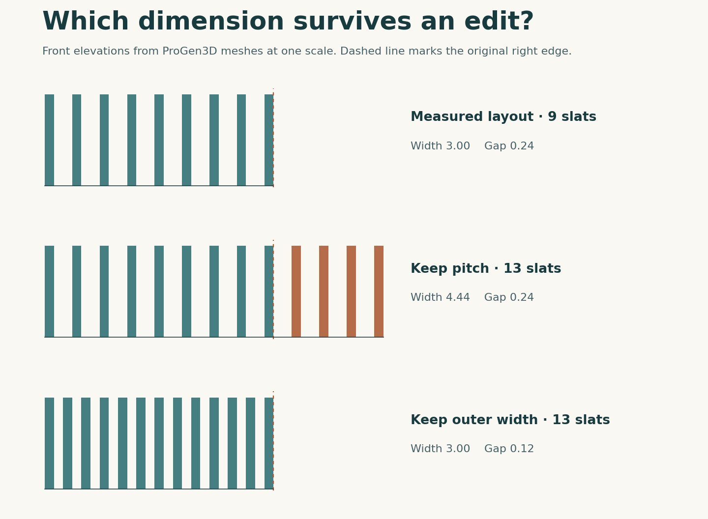
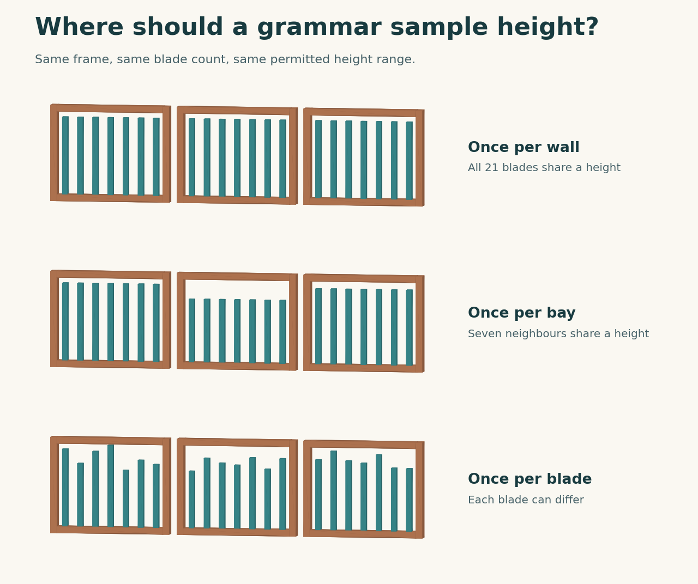
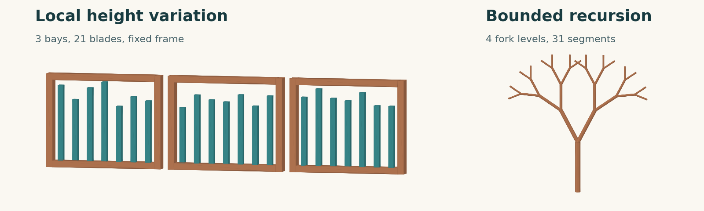

# How to turn a measured form into a ProGen3D grammar

A screen with nine slats can tell you where the slats sit. It takes a second design decision to say where a *tenth* slat belongs. This lab starts with one measured layout, writes two equally accurate grammars for it, and uses an edit to expose the difference. Two more examples apply the same method to assemblies and branching forms.



## 1. Infer a candidate rule from landmarks

Open [the literal layout](grammars/01_measured_layout.p3d). The left face is at zero, each blade is 0.12 units wide, and its first three centre coordinates are 0.06, 0.42 and 0.78. Their spacing suggests a translation of 0.36 per blade. Fit the candidate rule to those first three centres, then use it to predict the six you held back. The largest error measured on the exported geometry was 0.000000164 model units.

The reference here is a synthetic layout with known scale. For a chair or façade traced from a photograph, first mark an origin, a known length and homologous landmarks such as left and right joint centres. A second view can resolve depth. Keep the original measurements so you can see which details the inferred rule loses. Finding repetitions under a transformation is also an approach used in inverse procedural modelling. [Bokeloh, Wand and Seidel, 2010 (PDF)](https://www.staff.uni-mainz.de/wandm/papers/ProcModFromSym-siggraph2010.pdf)

## 2. Choose which dimension an edit must preserve

| Design intent | Grammar | What the repeat does |
|---|---|---|
| Extend a rack built on standard centres | [Fixed pitch](grammars/02_fixed_pitch.p3d) | Place one blade in a bracketed local frame, restore the parent frame, then advance it by one pitch. |
| Fit more blades inside a known opening | [Fixed span](grammars/03_fixed_span.p3d) | Compute each blade centre directly from its zero-based repeat index and the available width. |

For blade width *b*, pitch *p* and count *n*, the first design occupies *b + (n − 1)p*. In the second design, the first and last blades sit flush with the outer edges. With outer width *W* and at least two blades, the centre of blade *i* is *b/2 + i(W − b)/(n − 1)*. The single-blade case has its own rule and centres the blade in the opening.

The fixed-span grammar is short enough to use as a template.

```text
Start -> Screen(9 0.12 3)

Screen(n blade span) ->
    ?(n==1) Slat(span/2 blade) : Stations(n blade span)

Stations(n blade span) n ->
    Slat(blade/2+Stations_count*(span-blade)/(n-1) blade)

Slat(x blade) ->
    [ T(x 0.6 0) S(blade 1.2 0.08)
      I(Cube material(tealmattemetal) 1 1) ]
```

The following measurements come from the native mesh. All lengths are model units. At nine blades the largest corresponding vertex difference between the literal layout and either grammar was 0.00000048.

| Blades | Width at fixed pitch | Width at fixed span | Clear gap at fixed span |
|---:|---:|---:|---:|
| 1 | 0.12 | 0.12 occupied, centred at 1.50 | — |
| 9 | 3.00 | 3.00 | 0.24 |
| 13 | 4.44 | 3.00 | 0.12 |
| 25 | 8.76 | 3.00 | 0.00, touching |
| 26 | 9.12 | 3.00 | −0.0048, overlapping |

**Try a clearance requirement.** Suppose the opening is 3.00 and the minimum clear gap is 0.03. Each blade consumes *b* and each internal gap consumes at least *c*. The requirement is *nb + (n − 1)c ≤ W*, so the largest positive integer count is *floor((W + c)/(b + c))*. With 0.12-wide blades, predict the limit, then change the count in the editor. Twenty blades leave about 0.03158 between neighbours. Twenty-one leave 0.024. Both build successfully. Clearance needs a geometry check of its own.

## 3. Put a parameter where it should be shared

[The framed screen](grammars/04_bay_assembly.p3d) has three levels. The wall owns bay count and seam width. Each bay owns its frame and opening. Each blade samples its own height fraction in `Vary`. Seven blades and four frame pieces per bay produce 33 parts in the three-bay example. The test measures the gaps between bays, blade positions and the clearance envelope.

Move `R fraction(0.68 1.0)` from `Vary` to the beginning of `Start`. All 21 blades now take the same height. Move the sample again, this time to `Bay`. The seven blades in each panel now match, while heights vary across panels. The checker runs all three variants. This hierarchy follows a familiar procedural modelling technique of decomposing buildings into independently expressible parts. [Müller et al., 2006](https://emeritus.icu.ee.ethz.ch/research/demos/procedural-modeling.html)



## 4. Define the terminal part before adding recursion

[The recursive rib](grammars/05_recursive_rib.p3d) emits one straight sweep, even at depth zero. At positive depth, two bracketed children begin at its tip, turn through opposite angles and inherit 72% of its length and radius. The brackets give both children the same starting frame. Parametric branching and saved turtle state also appear in plant-modelling L-systems. [Prusinkiewicz et al. (PDF)](https://www.algorithmicbotany.org/papers/sigcourse.2003/2-1-lsystems.pdf)

Predict the size before increasing depth. A binary fork of depth *d* emits *2^(d+1) − 1* segments. At depth 4 the sampler returned 31 segments and 992 triangles. At depth 6 it returned 127 segments and 4,064 triangles. The checker also compares every child start and endpoint with the predicted position. A segment count alone would miss a misplaced sibling.



## Reproduce the investigation

With the desktop build dependencies installed, run these commands from the ProGen3D repository root using Python 3.10 or later.

```sh
make -j2 build/form-study-sample
python3 examples/FormStudies/authoring/check_lab.py --repo .
```

For a separately downloaded copy, run `python3 check_lab.py --repo /path/to/progen3d` from the lab directory after building the sampler in that checkout. Add `--keep-meshes /tmp/progen3d-authoring` to retain the world-space OBJ files. The checker uses an absolute tolerance of 0.00002 model units. All five default grammars also opened, regenerated and rendered in the desktop editor's isometric view.
