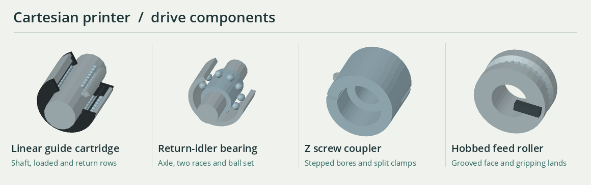

# Cartesian printer drive mechanics

The X toolhead, Y bed, twin-screw Z gantry and Bowden filament feeder have different load paths. All dimensions, masses, friction forces and material properties in this example are illustrative. The native grammar now draws the bearing and shaft interfaces described below. The force calculations identify which quantities a physical printer would need to supply.

## Component inspection

Open `CartesianPrinter.p3d` in the matching desktop build. The default start rule runs the loaded print. Set `Start -> BearingInspection` to view a sectioned linear cartridge on its journal, a sectioned return-idler bearing, a stepped shaft coupler and a grooved hob. Dimensions are in millimetres. The inspection uses the same productions as the machine.

| Assembly | Implemented geometry and motion | Physical interface and quantities to measure |
| --- | --- | --- |
| X carriage | Two 8 mm guide shafts, two cartridges on each shaft. The 240 mm span deflects under the carriage. | Hardened shaft race, loaded rolling elements, steel backing track, cage, return row, wiper and housing. Record shaft diameter, straightness, radial clearance, rod parallelism and wiper drag. Measure carriage pull force at both ends and the centre. |
| Y bed | Two 8 mm shafts, front and rear cartridges on each. The bearing centres are 104 mm apart across the bed and 58 mm apart along travel. | Bed, heater, plate, printed mass and cable loop all move. Acceleration acting above the guides creates a pitching moment. The four bearings can carry different normal loads. |
| Z guidance | Two vertical 8 mm guide shafts, upper and lower cartridges on each, spaced 28 mm vertically. | The guide rods react gantry moments. Measure binding through the full stroke and compare left and right lift under an off-centre head. |
| Z lift | Two screws with 2 mm pitch, four starts and 8 mm lead. Each has a stepped 5-to-8 mm split coupler, turned lower journal, central thrust washer, two ball rows and frame-mounted outer washers. The upper end is free in this example. | Gantry → sliding nut flanks → screw shoulder or retainer → thrust balls and housing washer → frame. The coupler transmits torque. A separate radial locating bearing, if fitted, needs its own seat, clearance and alignment. Check endplay at the screw independently of nut reversal. |
| X and Y timing drives | Each has a toothed motor pulley with split hub, two belt spans, an idler and a carriage clamp. Each idler has a fixed axle, inner and outer race and ten schematic balls. Tooth counts come from the axis declaration. | Record pitch and tooth profile, width, engaged teeth, pitch-line runout, belt modulus, installed tension, free-span length, clamp migration, idler misalignment and bearing torque. Smooth-back and toothed-face idlers require the corresponding belt-side geometry. |
| Feeder and spool | Separate hob and grooved pinch roller, exposed stock, Bowden section and downstream hotend. The geared model uses an 18-tooth pinion, 36-tooth wheel and 5 mm effective hob radius. | Support the driven hob on both sides where possible. Record hob runout, tooth profile, effective bite radius, pinch pivot geometry, spring preload, pinch bearing drag and spool breakaway torque. Spool drag referred to filament is approximately spool torque divided by current wound radius. |
| Motor and auxiliary rolling supports | X/Y motor shafts and two Z motor shafts are explicit. The motor internals, feeder shaft support bearings, pinch-bearing internals, spool support and driver boards remain candidates for separate component objects. | Capture front and rear motor bearings, shaft shoulders, axial retention, ring fits and allowable overhung load from the selected parts. Put each bearing loss on its own shaft. Place the pulley close to the supporting bearing to reduce the bending moment. |

The screw is 152 mm overall with 128 mm of thread above the turned lower assembly. The 14 mm cartridge is a schematic four-circuit design. Individual balls illustrate load and return paths. The full assembly uses prescribed carriage movement and effective drag. It does not integrate ball circulation, Hertzian stress or bearing life. The drawn 4.04 mm wiper bore radius leaves 0.04 mm of graphical radial clearance on the 4 mm shaft. Bearing operating clearance must come from the shaft, race geometry and installed housing fits.

THK specifies f6 or g6 shaft tolerance for normal clearance and h6 for a small gap in its high-accuracy LM series. Its standard LM shafts are specified at 58–64 HRC and Ra 0.20–0.40 µm. Treat these as a matched shaft/bushing example. A printed ABS or ordinary aluminium housing can carry the cartridge while a ground hardened shaft carries the rolling contact. Secure the cartridge axially with a shoulder and retainer. An individual radial set screw against the shell can distort it. For rotary bearings, track the ring that rotates relative to the load and the axial freedom available for thermal growth. [THK fits and mounting](https://www.thk.com/jp/en/products/other_linear_motion_guides/linear_bushing/design/0001/) · [THK shaft catalogue](https://tech.thk.com/en/products/pdf/en_a04_044.pdf) · [SKF bearing arrangements](https://cdn.skfmediahub.skf.com/api/public/0901d196802809de/pdf_preview_medium/0901d196802809de_pdf_preview_medium.pdf)

## Screws, belts and reversal

The present Z nut has 0.060 mm total axial play, equivalent to 2.7° of screw rotation at 8 mm lead. Gravity can keep a flank seated across a commanded reversal. Detect actual flank unloading before applying the full clearance in a higher-fidelity model. A split/preloaded nut trades reduced reversal play for additional drag and wear. Keep lead error per turn, axial bearing endplay, coupling wind-up and nut clearance as separate parameters. They have different signatures on a dial indicator. Thread flanks slide on this screw. A ball-screw conversion would require a different nut, friction model and preload specification. [Thomson lead screws and nuts](https://www.thomsonlinear.com/downloads/screws/Precision_Screws_ctuk.pdf)

With left and right screw axes at ±104 mm, a vertical resultant W acting at offset x gives static reactions Fᵣ = W(1 + x/104)/2 and Fₗ = W − Fᵣ in a simple two-support approximation (x in mm). Include the full gantry weight and moving head position when forming W and its moment. Raising torque per screw is Fᵢ ℓ/(2πη) plus bearing and seal torque, where ℓ is lead in metres per revolution. For an illustrative centred 2 kg gantry, 8 mm lead and assumed 0.35 raising efficiency, this is 0.0357 N·m per screw before bearing drag or angular acceleration. Measure raising and lowering separately to establish efficiency and backdrivability.

For a 20-tooth, 2 mm-pitch belt pulley the pitch radius is 6.366 mm and travel is 40 mm/rev. At 100 mm/s the motor turns 150 rpm. Using the grammar's moving masses and drag, a comparison at 2 m/s² gives the following. The simulated print has its own time-varying acceleration.

| Axis | Moving mass | Effective drag | Inertial force | Total belt force | Pulley torque | Reflected translational inertia |
| --- | ---: | ---: | ---: | ---: | ---: | ---: |
| X head | 0.42 kg | 1.4 N | 0.84 N | 2.24 N | 0.0143 N·m | 1.70 × 10⁻⁵ kg·m² |
| Y bed | 0.88 kg | 2.1 N | 1.76 N | 3.86 N | 0.0246 N·m | 3.57 × 10⁻⁵ kg·m² |

The table uses F = ma + drag, τ = rF and Jᵣₑ𝒻 = mr². Add rotor, pulley and reflected idler inertia once, through Jrot a/r at the motor, plus rotary drag. For example, each additional 100 g on the bed at this acceleration adds 0.20 N of belt force and 0.00127 N·m at the pulley. A head with a centre of mass a distance h above its guide plane adds the overturning moment mah. Flexing cables can add a position-dependent bias.

With nominal per-span tension T₀ of 8 N on X and 9 N on Y, the equal-stiffness taut-span estimate T₀ ± F/2 gives 9.12/6.88 N on X and 10.93/7.07 N on Y. For a near-180° wrap with parallel spans, the shaft sees approximately their sum, 16 or 18 N, before other loads. Over-tension raises the motor/idler bearing load even at rest. Tooth jumping depends on tooth engagement, profile, wrap and tension. The grammar's 17/18 N jumping thresholds are experimental inputs. A marked pulley/hub and a witnessed belt clamp distinguish hub spin and clamp creep from a skipped tooth. Check installed span tension with the same free span and belt mass each time. [Gates belt installation and sonic measurement](https://www.gatesaustralia.com.au/~/media/files/gates-au/industrial/catalogues/preventive-maintenance-manual-aus-nz-july-2019.pdf)

The 18:36 feeder gearbox has 0.8 mm module and nominal 20° pressure angle. With 0.025/0.035 mm tooth thinning and +0.035 mm centre-distance error, the first-order pitch-line gap is 0.025 + 0.035 + 2(0.035)tan(20°) = 0.0855 mm. At the wheel pitch radius of 14.4 mm that corresponds to about 0.030 mm of lost hob travel on a fully unloaded reversal. Keep this dead travel separate from pitch error, bearing play and hob/stock slip.

## Stepper, driver and shaft joints

Treat the motor as rotor inertia driven by two phase currents. The load angle between its electrical field and rotor produces torque. Inductance, back EMF, bus voltage and current regulation determine the current that actually develops at speed. The acceleration ramp, load inertia and resonance affect synchronism. For sizing, compare required torque with the pull-out curve at each speed, including reversals and hot operation. Add a measured operating margin. Represent a lost step separately from a pulley turning on its shaft. [Oriental Motor torque curves](https://www.orientalmotor.com/stepper-motors/technology/stepper-motor-basics.html)

Two 42 mm frame reference motors give the scale. The 17HS13-0404S1 is rated 0.26 N·m holding, 0.4 A/phase, 30 Ω and 37 mH. The 17HS19-2004S1 is rated 0.59 N·m holding, 2.0 A/phase, 1.6 Ω and 3 mH. Its published pull-out curve at 24 V, 2 A, half-step is approximately 0.42 N·m at 150 rpm and 0.23 N·m at 750 rpm. The actual printer motor, current settings and cooling have not been identified. [0.26 N·m motor](https://www.stepperonline.com.au/nema-17-bipolar-1-8deg-26ncm-36-8oz-in-0-4a-12v-42x42x34mm-4-wires-17hs13-0404s1.html) · [0.59 N·m motor](https://www.stepperonline.com.au/nema-17-bipolar-59ncm-84oz-in-2a-42x48mm-4-wires-w-1m-cable-connector-17hs19-2004s1.html) · [Running torque curve](https://www.oyostepper.com/images/upload/File/17HS19-2004S1_Torque_Curve%281%29.pdf)

A TMC2209 provides STEP/DIR, UART settings, run/hold current control, microstepping, quiet StealthChop and SpreadCycle mixed-decay control. Store actual carrier-board ratings, sense resistor or current-sense mode, bus voltage, run/hold current, mode and thermal warning state in a driver object. Reconcile the driver's RMS current convention with the motor's phase rating. Verify the carrier's thermal capacity. A 1.8° motor at 1/16 step gives 0.0125 mm nominal belt travel per command, while drag, elastic deflection and available incremental torque determine achieved positioning. [Analog Devices TMC2209](https://www.analog.com/en/products/TMC2209.html) · [Driver data sheet](https://www.analog.com/media/en/technical-documentation/data-sheets/tmc2209_datasheet_rev1.09.pdf)

For measured per-phase RMS currents, winding loss is Pcu = R(T)(Ia,rms² + Ib,rms²). At 1.6 Ω and 1.0 A RMS in each winding, the calculated cold copper loss is 3.2 W. At half that current it is 0.8 W. Lower standstill current also reduces available holding torque, which matters on gravity-loaded Z. Model warm-up with Cθ dT/dt = Pcu + Piron − (T − Tamb)/Rθ. Record winding/case and driver temperatures separately, as the motor mount, airflow and driver PCB dissipate heat differently. Determine Rθ from a steady rise at known power and Cθ from the warm-up time constant. A winding resistance measurement can help estimate average winding temperature. The present solver applies a prescribed nozzle-stack expansion and does not predict motor temperature or missed steps.

| Shaft attachment | Object and failure model | Measurement |
| --- | --- | --- |
| Printed ABS interference fit on steel | Bore, engagement length, hub wall, layer orientation, temperature and relaxation time. Interference loads the wall in hoop tension. Thermal expansion and stress relaxation can lower contact pressure. | Measure shaft and conditioned bore, then record breakaway torque cold, after heat soak and after reversals. Repeat across print orientations. |
| Aluminium interference hub | Use signed actual interference, hub OD, shaft diameter, contact length, surface finish and friction. Calculate contact pressure with a thick-cylinder fit model, then check stress and torque capacity. | Check the shaft tolerance, runout, insertion load and manufacturer-permitted axial assembly load. Fixture the shaft so pressing does not drive the assembly load through the motor bearings. |
| Aluminium split clamp | Model bore, slit, fastener preload and hub stiffness. For a printed wheel, a piloted metal clamp hub can carry shaft torque while a bolted flange carries it into the wheel. | Use the selected hub's screw specification. Measure breakaway, bore concentricity and witness-mark drift after hot reversals. |
| Radial set screw on a D-flat | Put the screw in a threaded metal hub with the tip on the flat. Track local indentation and angular seating play. A single screw in a thin printed boss can strip or creep. | Inspect witness marks on shaft **and** hub. Check axial retention separately, particularly on a vertical screw. |

For a concentric circular interference fit, uniform mean pressure p gives an ideal gross-slip torque of μπpd²L/2, using consistent units. This expression does not convert tightening torque directly into clamp pressure, and a D-flat changes the contact area. There is no universal bore undersize or screw tightening torque across printed ABS, aluminium, different hub walls and fastener grades. [GE Plastics press-fit design](https://www.controlplastics.com/technical-resources/GEP_Design_Guide.pdf) · [Ruland shaft collars and couplings](https://www.bearing.net.au/wp-content/uploads/2017/06/Ruland.CollarsRidgid.Couplings.pdf)

## Hob pressure, back pressure and slip

The spring sets normal force N at the nip after applying the lever ratio. Average tooth contact pressure is N divided by the *actual* contact patch. Nozzle back pressure P is a different quantity. It creates an axial resistance approximately AP at the feeder, where A = πd²/4 = 2.4053 mm² for the model's 1.75 mm stock. The default model gives traction Fgrip = μeff N. A more complete sustainable force is

    Favail = min(μeff N, ηgear G τmotor / rhob, Fstrip, Fbuckle)
    force margin = Favail − (AP + Fguide + Fspool)

The torque term uses motor torque available at feeder speed, gear ratio G and working radius in metres. The strip and buckle limits depend on tooth geometry, material, temperature and guide spacing. For an unsupported straight section, an Euler estimate π²EI/(KL)² can screen the effect of guide length. Soft filament, lateral contact and geometric imperfections require a bench measurement. The lumped Bowden compliance already stores volume, so its elastic force must not be added a second time to AP at static equilibrium.

With 33 N and μeff = 0.33, the present contact cap is 10.89 N. The 5 mm hob needs 0.0545 N·m at that cap, or 0.0272 N·m at the motor with ideal 2:1 reduction. At 85% assumed gear efficiency the latter rises to 0.0320 N·m, before other feeder losses. Peak simulated pressure of 3.635 MPa consumes 8.74 N. This leaves 2.15 N for additional resistance before predicted gross slip. Adding a steady 2 N path resistance would reduce the available pressure ceiling from 4.528 to 3.696 MPa. That drag example is a force-budget calculation, separate from the native runs below.

**Native preload sweep**, same flexible stock, nozzle, speed program and 28.5 s endpoint. Slip is cumulative hob surface travel in excess of stock accepted by the nip. Peak shortening is elastic/viscoelastic deformation downstream.

| Nip force | Peak pressure (MPa) | Cumulative slip (mm) | Peak shortening (mm) | Deposited on print moves (mm³) |
| ---: | ---: | ---: | ---: | ---: |
| 33 N | 3.635 | 0.000 | 5.336 | 43.872 |
| 27 N | 3.635 | 0.000 | 5.336 | 43.872 |
| 24 N | 3.293 | 0.998 | 4.878 | 42.650 |
| 20 N | 2.744 | 3.765 | 4.071 | 38.136 |
| 15 N | 2.058 | 8.282 | 3.056 | 30.204 |

For this print the transition is near N = APpeak/μeff = 26.5 N. The model has an idealised gross-slip threshold. Roller experiments on PLA found load-dependent slip below maximum transferable force, and sensitivity to pinch force, feed velocity and tooth geometry. Flexible filament needs its own measured traction curve. More nip force can leave deeper tooth marks, ovalise the stock and increase guide drag. [Nienhaus et al., Investigations on Roller-Based Filament Drives](https://www.mdpi.com/2504-4494/5/2/53)

## Bench tests that separate the mechanisms

1. Disconnect each belt and pull the carriage at slow constant speed in both directions. Record breakaway, moving drag and variation along the stroke. Refit the belt and measure span tension, pulley runout and carriage reversal error independently.
2. Indicate each screw axially against the frame, then indicate the nut against its screw. Repeat under upward and downward applied loads. Traverse with the head at left, centre and right to expose guide misalignment and unequal lift.
3. Mark each shaft, hub and belt clamp. Run identical acceleration sweeps cold and after thermal equilibrium. Record independent shaft or carriage position against commanded steps, current, motor case/driver temperature and ambient. Check which pair of marks moved first.
4. Calibrate pinch-roller force from the spring and lever at operating filament diameter. Measure the hob angle, actual incoming stock travel and axial reaction with a load cell simultaneously. Repeat at several speeds, pinch forces and temperatures for each filament. Record tooth damage or sideways buckling. Compare travel near the hob with discharged mass to separate slip from pressure storage and delayed ooze.
